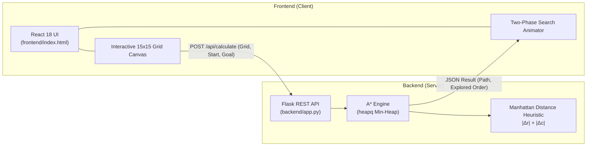

# Smart Warehouse Routing Engine 🤖📦

[](https://www.python.org/)
[](https://flask.palletsprojects.com/)
[](https://react.dev/)
[](https://tailwindcss.com/)
[](LICENSE)

An interactive, full-stack Artificial Intelligence visualizer built to demonstrate state-space search algorithms in automated fulfillment centers. This project implements the **$A^*$ (A-Star) search algorithm** with an admissible **Manhattan distance heuristic** to calculate the mathematically optimal route for an autonomous guided vehicle (AGV / forklift) navigating around dynamic storage rack obstacles.

---

## 📑 Table of Contents

- [Problem Statement](#-problem-statement)
- [System Architecture](#-system-architecture)
- [Algorithmic & Mathematical Foundation](#-algorithmic--mathematical-foundation)
  - [State-Space Formulation](#state-space-formulation)
  - [Heuristic Function & Admissibility](#heuristic-function--admissibility)
- [Complexity Analysis](#-complexity-analysis)
- [Core Features](#-core-features)
- [Project Structure](#-project-structure)
- [API Specification](#-api-specification)
- [Getting Started](#-getting-started)
  - [Prerequisites](#prerequisites)
  - [1. Backend Setup](#1-backend-setup)
  - [2. Frontend Setup](#2-frontend-setup)
- [Interface & Controls Guide](#-interface--controls-guide)
- [Further Documentation](#-further-documentation)
- [Future Roadmap](#-future-roadmap)
- [License](#-license)

---

## 🎯 Problem Statement

In modern automated distribution and fulfillment centers (e.g., Amazon Kiva / Proteus architectures), fleets of autonomous robotic vehicles must retrieve packages while avoiding storage racks, work stations, and dynamic floor hazards.

This project solves the **single-agent discrete pathfinding problem** by decoupling a high-performance Python algorithmic backend from a lightweight, responsive React visual frontend. The visualizer explicitly surfaces the internal state of the search tree, distinguishing between candidate node evaluations and final path execution.

---

## 🏗️ System Architecture

The application adopts a decoupled client-server architecture with zero frontend build dependencies:



- **Frontend Client (`frontend/index.html`):** Standalone React 18 application with Tailwind CSS and Lucide icons loaded via CDN (no Node.js build step needed). Owns layout state, mouse drag-and-paint events, and frame-by-frame traversal animations.
- **Algorithmic Backend (`backend/app.py`):** Flask microservice with CORS enabled. Validates grid dimensions, manages open/closed priority sets, and returns the expanded node sequence alongside the reconstructed shortest path.

---

## 🧮 Algorithmic & Mathematical Foundation

### State-Space Formulation

The warehouse floor is modeled as a discrete 2D grid graph $G = (V, E)$:

* **State ($s$):** A grid coordinate pair $s = (r, c)$ where $0 \le r < N$ and $0 \le c < N$ ($N = 15$).
* **Initial State ($s_0$):** Starting coordinates of the robot.
* **Goal State ($s_g$):** Destination coordinates of the target inventory item.
* **Legal Actions ($A$):** 4-way orthogonal movement:
  $$\Delta \in \{(0, 1), (1, 0), (0, -1), (-1, 0)\}$$
  *(Diagonal traversal is disallowed to prevent corner-cutting through storage racks).*
* **Step Cost ($c$):** Uniform unit cost for every legal transition:
  $$c(s, s') = 1$$
* **Obstacles:** Cells marked as occupied storage racks (`walls[r][c] = true`) are untraversable states.

### Heuristic Function & Admissibility

The evaluation function for any candidate node $n$ is:

$$f(n) = g(n) + h(n)$$

Where:
* **$g(n)$** is the exact path cost accumulated from $s_0$ to node $n$.
* **$h(n)$** is the estimated remaining cost from node $n$ to $s_g$.

Since movement is strictly 4-directional and uniform, the **Manhattan Distance (L1 norm)** serves as the heuristic:

$$h(n) = |r_n - r_g| + |c_n - c_g|$$

#### Admissibility & Optimality
Because an agent must travel at least $|r_n - r_g|$ vertical steps and $|c_n - c_g|$ horizontal steps in a grid with unit weights:

$$h(n) \le h^*(n) \quad \forall n \in V$$

where $h^*(n)$ represents the true optimal cost to the goal. Because $h(n)$ never overestimates the actual cost, it is **admissible** and **consistent** (monotone). Therefore, $A^*$ guarantees finding the **mathematically optimal shortest path**.

---

## ⏱️ Complexity Analysis

| Metric | Bound | Warehouse Grid ($N=15, V \le 225$) |
| :--- | :--- | :--- |
| **Worst-Case Time** | $\mathcal{O}((V + E) \log V) = \mathcal{O}(N^2 \log N)$ | $\approx 225 \log_2(225) \approx 1{,}750$ ops |
| **Worst-Case Space** | $\mathcal{O}(V + E) = \mathcal{O}(N^2)$ | $\le 225$ cell states |
| **Branching Factor** | $b \le 4$ (orthogonal neighbors) | Bounded by boundary walls |

* With Python's binary min-heap (`heapq`), push and pop operations run in $\mathcal{O}(\log |V|)$ time.
* Hash maps (`dict`) provide $\mathcal{O}(1)$ average-time lookups for `g_score` and parent reconstruction pointers (`came_from`).
* Setting $h(n) = 0$ degenerates $A^*$ into Dijkstra's Algorithm / Breadth-First Search (BFS).

---

## ✨ Core Features

* 🖱️ **Interactive Floor Plan Designer:** Click or drag across the grid to paint storage racks and obstacles in real time.
* 🤖 **Dynamic Agent Relocation:** Switch placement modes to reposition the robot start coordinate or package drop-off destination anywhere on the floor.
* ⚡ **Algorithmic Decoupling:** Pure separation of concerns; all pathfinding logic runs exclusively on the Python server via a clean REST API.
* 🎬 **Two-Phase Search Visualization:**
  1. *Exploration Phase:* Animates the exact expansion sequence of the open frontier / closed set.
  2. *Path Execution Phase:* Traces the final reconstructed optimal trajectory cell by cell.
* 📊 **Telemetry & Performance Metrics:** Displays real-time counts of nodes explored versus final path length, complete with edge-case detection (unreachable targets).
* 🎨 **Modern Cyber-Industrial UI:** Glassmorphism styling, ambient radial gradients, glowing status indicators, and full accessibility support.

---

## 📁 Project Structure

```text
smart-warehouse-routing-engine/
├── backend/
│   ├── app.py              # Flask REST API & A* graph-search algorithm
│   └── requirements.txt    # Python dependencies (Flask, flask-cors)
├── frontend/
│   └── index.html          # Self-contained React 18 UI with Tailwind CSS & Lucide icons
├── docs/
│   ├── architecture.md     # Detailed architecture diagrams & data contracts
│   └── time_complexity.md  # Formal asymptotic time/space proofs
├── .gitignore              # Git ignore rules for Python environments & caches
└── README.md               # Project documentation
```

---

## 🔌 API Specification

### `POST /api/calculate`

Computes the shortest path from start to goal given a 2D boolean obstacle matrix.

#### Request

* **URL:** `http://localhost:5000/api/calculate`
* **Method:** `POST`
* **Content-Type:** `application/json`

```json
{
  "walls": [
    [false, false, false],
    [false, true,  false],
    [false, false, false]
  ],
  "start": { "r": 0, "c": 0 },
  "goal":  { "r": 2, "c": 2 }
}
```

#### Response (Success - Path Found)

* **Status:** `200 OK`

```json
{
  "found": true,
  "path": [
    { "r": 0, "c": 0 },
    { "r": 0, "c": 1 },
    { "r": 0, "c": 2 },
    { "r": 1, "c": 2 },
    { "r": 2, "c": 2 }
  ],
  "explored": [
    { "r": 0, "c": 0 },
    { "r": 0, "c": 1 },
    { "r": 1, "c": 0 },
    { "r": 0, "c": 2 }
  ]
}
```

#### Response (Unreachable Target)

* **Status:** `200 OK`

```json
{
  "found": false,
  "path": [],
  "explored": [ ... ]
}
```

#### Test with cURL

```bash
curl -X POST http://localhost:5000/api/calculate \
  -H "Content-Type: application/json" \
  -d '{"walls":[[false,false],[false,false]],"start":{"r":0,"c":0},"goal":{"r":1,"c":1}}'
```

---

## 🚀 Getting Started

### Prerequisites

* **Python 3.8+** installed on your system.
* A modern web browser (Chrome, Firefox, Safari, Edge).

### 1. Backend Setup

Open a terminal and navigate to the `backend` folder:

```bash
# 1. Navigate to backend
cd backend

# 2. (Optional but recommended) Create a virtual environment
python -m venv venv
source venv/bin/activate       # On Linux/macOS
# .\venv\Scripts\activate      # On Windows

# 3. Install dependencies
pip install -r requirements.txt

# 4. Start the Flask server
python app.py
```

The backend server will launch at `http://localhost:5000`.

### 2. Frontend Setup

The frontend is a single, zero-build HTML document.

#### Option A: Open directly in your browser
Simply double-click `frontend/index.html` or open it with your favorite browser:
```bash
# On Linux
xdg-open frontend/index.html

# On macOS
open frontend/index.html

# On Windows
start frontend/index.html
```

#### Option B: Serve via a lightweight local server
```bash
# Run from the repository root
python -m http.server 3000
```
Then visit `http://localhost:3000/frontend/` in your browser.

---

## 🎮 Interface & Controls Guide

| Control | Mode / Action | Description |
| :--- | :--- | :--- |
| **Obstacles** | Wall Paint Mode | Click and drag on any grid cell to create or erase warehouse storage racks. |
| **Robot** | Start Point Mode | Click any traversable cell to position the AGV / forklift (Emerald marker). |
| **Target** | Goal Point Mode | Click any traversable cell to place the target inventory package (Amber marker). |
| **Calculate Path** | Trigger Search | Sends current grid state to the backend and plays the search animation. |
| **Clear Grid** | Reset | Clears all obstacles and resets the robot and target to default locations. |

### Visual Legend

* 🟩 **Emerald:** Robot starting position ($s_0$)
* 🟨 **Amber:** Package goal destination ($s_g$)
* ⬛ **Dark Slate:** Warehouse storage rack / wall obstacle
* 🟪 **Indigo Glow:** Explored node in the $A^*$ search frontier
* 🟦 **Cyan Trace:** Final mathematically optimal path

---

## 📚 Further Documentation

For deep dives into the theoretical foundations and implementation details, check out:
* [System Architecture Specification](docs/architecture.md) — Detailed request/response cycle, state-space representations, and component breakdowns.
* [Algorithmic Complexity Analysis](docs/time_complexity.md) — Asymptotic runtime proofs, heap analysis, and graph vs. tree search boundaries.

---

## 🔮 Future Roadmap

- [ ] **Multi-Agent Path Finding (MAPF):** Conflict-Based Search (CBS) for simultaneous multi-robot coordination without collisions.
- [ ] **Dynamic Moving Obstacles:** Time-expanded state graph $s = (r, c, t)$ for moving worker avoidance.
- [ ] **Diagonal & Continuous Movement:** Support for 8-way traversal using Euclidean / Chebyshev heuristics.
- [ ] **Rack Elevation (3D Routing):** Multi-level rack stacking and vertical lift travel costs.

---

## 📄 License

This project is licensed under the [MIT License](LICENSE) — feel free to use, modify, and build upon this project for educational and research purposes.
