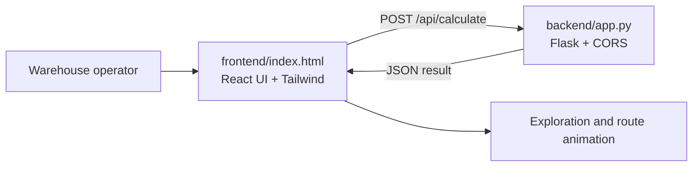

# System Architecture: Smart Warehouse Routing Engine

The project is a small client-server application that makes A* pathfinding visible. The browser owns the interactive warehouse editor and animation; the Flask service owns route calculation.

## Components



### Frontend

`frontend/index.html` is a self-contained React page. It renders a fixed 15 x 15 grid and stores the current walls, start point, goal point, placement mode, and animation state. The operator can:

- Paint and erase rack cells in **Obstacles** mode.
- Move the robot or target by switching to **Robot** or **Target** mode.
- Submit the current grid to the backend with **Calculate Path**.
- Watch explored nodes appear first, followed by the final route.

The page loads React, ReactDOM, Babel, and Tailwind from CDNs, so no frontend build step is required.

### Backend

`backend/app.py` exposes a Flask endpoint on port `5000`. Flask-CORS allows the browser page to call the API during local development. The backend validates the grid boundaries while running A*, tracks parent links for reconstruction, and returns the search trace as JSON.

## State-Space Representation

The warehouse is a discrete 2D grid graph:

- **State ($s$):** A cell represented by `{ "r": row, "c": column }`.
- **Initial state ($s_0$):** The robot's start coordinate.
- **Goal state ($s_g$):** The target coordinate.
- **Actions ($A$):** Up, down, left, or right. Diagonal movement is not allowed.
- **Step cost:** Every legal move costs `1`.
- **Blocked states:** Cells marked `true` in `walls` cannot be entered.

The current interface uses a 15 x 15 grid, while the backend derives the grid size from the submitted `walls` matrix.

## Request and Response Contract

The frontend sends:

```http
POST http://localhost:5000/api/calculate
Content-Type: application/json
```

```json
{
  "walls": [[false, false], [false, false]],
  "start": {"r": 0, "c": 0},
  "goal": {"r": 1, "c": 1}
}
```

The service returns:

```json
{
  "found": true,
  "path": [{"r": 0, "c": 0}, {"r": 0, "c": 1}, {"r": 1, "c": 1}],
  "explored": [{"r": 0, "c": 0}, {"r": 0, "c": 1}, {"r": 1, "c": 1}]
}
```

`found` is `false` and `path` is empty when the open set is exhausted without reaching the target. `explored` remains available so the UI can show how far the search progressed.

## The Manhattan Heuristic

For a cell $n$, the heuristic is:

$$h(n) = |r_{current} - r_{goal}| + |c_{current} - c_{goal}|$$

The backend prioritizes each candidate using:

$$f(n) = g(n) + h(n)$$

where $g(n)$ is the exact cost from the start and $h(n)$ estimates the remaining cost. Because movement is orthogonal and every step costs `1`, Manhattan distance never overestimates the true remaining cost. It is therefore admissible, and A* returns a shortest route when one exists.

## End-to-End Flow

1. The operator edits the grid in the browser.
2. The frontend sends the complete grid, start, and goal as JSON.
3. Flask runs A* and records nodes in expansion order.
4. The backend returns the route and exploration trace.
5. React animates the trace and updates the explored-node and path-length metrics.
